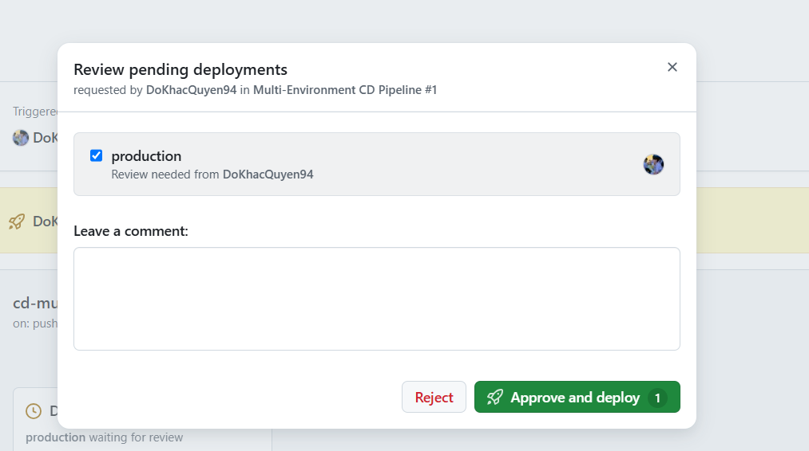

# IT209 - Session 12: Bài tập 03 - Tách biệt luồng CI/CD đa môi trường với GitHub Environments

## 1. Tổng quan
Dự án minh họa quy trình CD đa môi trường sử dụng **GitHub Actions** và **GitHub Environments**:
- **Staging**: Tự động triển khai khi có commit đẩy lên nhánh `develop`.
- **Production**: Yêu cầu phê duyệt thủ công (**Manual Approval / Required Reviewers**) trước khi triển khai khi đẩy lên nhánh `main`.

## 2. Thông tin bài làm
- **Môn học**: IT209 - DevOps & CI/CD
- **Bài tập**: Bài 3 - Tách biệt luồng CI/CD đa môi trường (Staging & Production) với GitHub Environments
- **Tác giả / Reviewer**: `@DoKhacQuyen94`
- **Repository**: [DoKhacQuyen94/IT209_Session12_HW_baitap03](https://github.com/DoKhacQuyen94/IT209_Session12_HW_baitap03)
- **Thư mục bài tập**: `homework/session_12/ex3/`
- **Tệp kịch bản workflow**: `.github/workflows/cd-multi-env.yml`

## 3. Cấu hình môi trường (GitHub Environments)
| Môi trường | Nhánh kích hoạt | URL triển khai | Quy tắc bảo vệ (Protection Rules) |
| :--- | :---: | :---: | :--- |
| **staging** | `develop` | `https://api.staging.example.com` | Không có (Deploy tự động) |
| **production** | `main` | `https://api.prod.example.com` | **Required reviewers**: `@DoKhacQuyen94` |

## 4. Minh chứng phê duyệt Production (Waiting for review)

